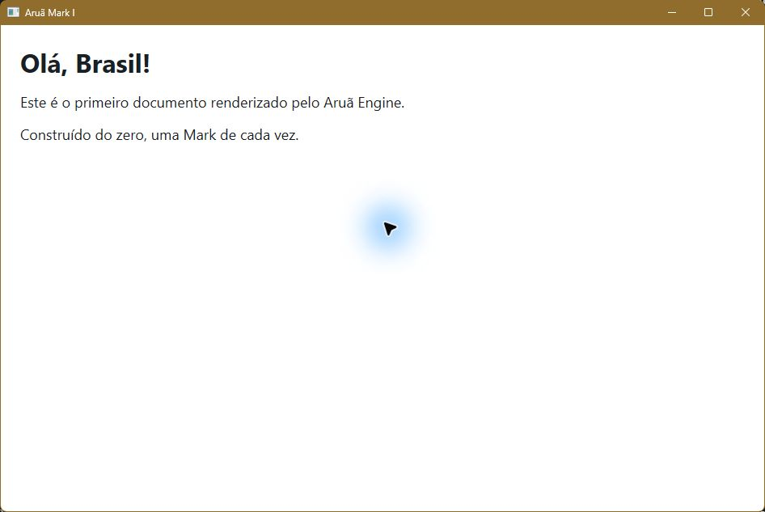
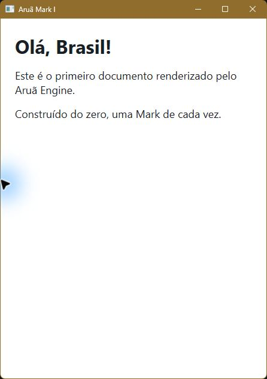

# Aruã Browser — Mark I: O Despertar

Data: 9 de novembro de 2026 (America/Sao_Paulo).

Status: concluída. O executável Windows x64 abre uma janela Win32, interpreta
o HTML local com código próprio e renderiza o cabeçalho e os parágrafos com
Direct2D/DirectWrite. O título HTML aparece na legenda nativa. Mark II não iniciada.

## Arquitetura implementada

| Arquivo | Responsabilidade |
| --- | --- |
| `src/main.rs` | Argumento de caminho, documento padrão, tratamento de erros e código de saída |
| `src/html.rs` | Leitura limitada, validação UTF-8, tokenizer, entidades e parser próprio |
| `src/document.rs` | `Document`, título e sequência ordenada de `Heading`/`Paragraph` |
| `src/platform.rs` | Janela Win32, apartamento COM, mensagens, redimensionamento e ciclo de vida |
| `src/render.rs` | Recursos Direct2D/DirectWrite, layout de texto e fluxo vertical dos blocos |
| `examples/mark_i.html` | Documento solicitado na missão, preservando texto e acentos |

A representação é um documento semântico mínimo, e não um DOM completo.
Os elementos estruturais são validados e não são retidos como nós. O título e
os blocos visíveis são retidos na ordem do documento. O parser não depende de
Win32, não usa regex e não executa conteúdo do arquivo.

Não foram adicionados JavaScript, rede, abas, histórico, favoritos, CSS ou
infraestrutura para funcionalidades futuras.

## Contrato do subconjunto HTML

Esta gramática deliberadamente estrita não implementa HTML5 nem a recuperação
de erros de um navegador moderno.

- Entrada UTF-8, com BOM UTF-8 inicial opcional e limite de 1 MiB. A leitura do
  arquivo também é limitada, antes de converter ou interpretar o conteúdo.
- Um único `html`, contendo um `head` opcional seguido de um único `body`.
- `head` aceita somente espaços/comentários e um `title` opcional. Seu conteúdo
  não é renderizado no cliente. `title` fornece a legenda da janela.
- `body` aceita blocos `h1` e `p`, em qualquer quantidade, separados por
  espaços ou comentários. Não há elementos inline ou blocos aninhados.
- `title`, `h1` e `p` aceitam texto e comentários. Todas as tags devem ter
  fechamentos explícitos e corretamente aninhados.
- Nomes de tags não diferenciam maiúsculas de minúsculas. Espaços HTML antes
  do `>` são aceitos. Atributos e tags autocontidas são rejeitados.
- `<!DOCTYPE html>` é opcional, sem diferenciar caixa, uma vez antes do `html`.
  Não são aceitos identificadores públicos, DTDs ou outras declarações.
- Comentários `<!-- ... -->` são ignorados; comentários não terminados ou com
  `--` interno são rejeitados. Não é suportado CDATA.
- Espaço, tabulação, CR, LF e form feed são colapsados dentro dos textos.
  Espaços nas extremidades são removidos. NBSP é preservado.
- Entidades aceitas: `amp`, `lt`, `gt`, `quot`, `apos`, `nbsp` e referências
  numéricas decimais/hexadecimais válidas, com `;` obrigatório. Entidades
  desconhecidas, NUL, substitutos Unicode e valores fora do intervalo são erros.
  Controles que não sejam espaços HTML são rejeitados. Não se reinterpreta
  como markup um `<` produzido por entidade.
- Texto fora de `title`, `h1` ou `p` é rejeitado, exceto espaços HTML.
- Título ausente/vazio resulta em `Aruã Mark I`. Blocos vazios são aceitos e
  reservam altura mínima no fluxo.
- Elementos desconhecidos (inclusive `script`, `style`, `div`, `a`, `img`),
  atributos, processamento XML e estrutura malformada resultam em erro explícito.

## Renderização e comportamento da janela

O cliente tem fundo branco e texto escuro, com margem de 24 unidades de layout.
`h1` usa Segoe UI negrito em 32 DIPs; `p` usa Segoe UI normal em 18 DIPs.
São estilos fixos da Mark I, não uma implementação de CSS.

O Aruã organiza os blocos verticalmente. DirectWrite fornece medição,
modelagem tipográfica e quebra de texto dentro da largura disponível; Direct2D
desenha o texto. O bloco seguinte usa a altura medida do anterior e um
intervalo fixo de 16 DIPs. O layout é recalculado ao repintar após `WM_SIZE`.
Minimização/tamanhos zero não solicitam targets de tamanho inválido.

O desenho ocorre em `WM_PAINT`, sem loop contínuo de renderização. O render
target e o pincel são reutilizados. `D2DERR_RECREATE_TARGET` descarta ambos e
solicita nova pintura; outros erros gráficos fecham a janela e são reportados.
O caminho de perda de dispositivo foi implementado, mas não foi forçado nos
testes desta máquina.

## Dependências e ambiente

Uma dependência direta: `windows = 0.62.2`, da Microsoft, fixada no manifesto.
Ela fornece os bindings Win32, Direct2D, DirectWrite e COM; não implementa
parser HTML, DOM ou motor web. O `Cargo.lock` fixa as 15 crates da árvore de dependências,
incluindo os tipos auxiliares e macros da integração Windows. A árvore completa
está em [MARK_I_dependencies.txt](MARK_I_dependencies.txt).

Não há dependência de Chromium, WebKit, Gecko, Servo, WebView2 ou Electron.
As importações do executável confirmam `user32.dll`, `d2d1.dll`, `dwrite.dll`,
COM e o runtime C/Windows; ver [MARK_I_binary.txt](MARK_I_binary.txt).

Ambiente reutilizado da Mark 0:

- Windows 11 Professional x64, NT 10.0.26200.
- Toolchain `stable-x86_64-pc-windows-msvc`, rustc/Cargo 1.99.1.
- Visual Studio Community 2026, MSVC 19.51.36252 e Windows SDK 10.0.26100.0.

Não houve instalação/alteração de ferramentas globais nesta missão.

## Compilação e execução

Na raiz `C:\Dev\Arua`:

```powershell
cargo test --locked --offline
cargo build --release --locked --offline --target x86_64-pc-windows-msvc
.\target\x86_64-pc-windows-msvc\release\Arua.exe
.\target\x86_64-pc-windows-msvc\release\Arua.exe "C:\caminho\documento.html"
```

O modo offline pressupõe que as crates já foram adquiridas. Na primeira
preparação foi usado `cargo fetch`; o aplicativo não usa a rede.

Sem argumento, o executável lê o arquivo de exemplo no caminho do checkout
gravado na compilação. Isso não é um instalador/distribuição independente.
Ao copiar o binário para outro computador, forneça um arquivo explícito e
garanta os runtimes Windows/MSVC necessários. Caminhos relativos explícitos
são resolvidos a partir do diretório corrente.

Artefato: `target\x86_64-pc-windows-msvc\release\Arua.exe`.

- Build release: passou, sem warnings na compilação final.
- Formato validado: PE AMD64 (`0x8664`), subsystem Windows GUI (`2`).
- Tamanho: 194.048 bytes.
- SHA-256: `19F9FAD3A7A9C05F6A796E4A47BEDAB2E6B86F7681B52D5911B2C5CADD967B82`.

Log: [MARK_I_build.txt](MARK_I_build.txt). O hash identifica esta compilação;
não há garantia de build reproduzível ou assinatura digital.

## Testes executados

### Automatizados

`cargo test --locked --offline`: **9 testes passaram; 0 falhas**.

1. Documento da missão: título, acentos, três blocos e ordem exata.
2. BOM, caixa das tags, comentários e colapso de espaços HTML.
3. Entidades suportadas, Unicode e preservação de NBSP.
4. Rejeição de elementos, atributos, scripts, autocontidas e aninhamento inválido.
5. Rejeição de tags faltantes, fechamento incorreto, seções duplicadas e texto excedente.
6. Rejeição de tokens/entidades incompletos, NUL e valores Unicode inválidos.
7. Blocos vazios e título padrão.
8. UTF-8 inválido e limite de tamanho.
9. Leitura do exemplo real do disco e erro de arquivo inexistente.

Saída completa: [MARK_I_tests.txt](MARK_I_tests.txt).

### Execução real e inspeção visual

- Janela nativa abriu com legenda `Aruã Mark I`.
- `Olá, Brasil!` e os dois parágrafos apareceram com todos os acentos.
- Maximizar e restaurar repintaram o documento corretamente.
- Janela estreitada para aproximadamente 446 pixels: primeiro parágrafo
  quebrou em duas linhas e o segundo foi reposicionado sem sobreposição.
- Abertura com caminho explícito a partir de outro diretório funcionou.
- Fechamento por Alt+F4 encerrou o processo com código **0**.
- Arquivo inexistente, arquivo com bytes UTF-8 inválidos e documento contendo
  `script` exibiram diálogo de erro. Após confirmação, cada processo encerrou
  com código **1**, sem crash ou execução de script.
- Todas as janelas/processos de teste foram fechados ao final.

Registros: [MARK_I_ui.txt](MARK_I_ui.txt) e [MARK_I_errors.txt](MARK_I_errors.txt).





## Memória observada

Foi medido o processo release depois da primeira renderização do exemplo,
em repouso, antes dos testes de redimensionamento. Cinco amostras de
`Get-Process`, espaçadas por 500 ms, mostraram:

- Working set: **45.928.448 bytes (43,8 MiB)** em todas as amostras.
- Memória privada: **55.730.176 bytes (53,1 MiB)** em todas as amostras.
- Handles: **415**, estáveis nessa pequena janela de observação.
- Processo responsivo em todas as amostras.

Dados: [MARK_I_memory.json](MARK_I_memory.json). Working set e memória privada
são métricas diferentes; não devem ser somadas. Os valores dependem do Windows,
driver gráfico e estado dos caches. Não medem pico instantâneo de inicialização,
uso total da GPU ou consumo mínimo. Não foi feito perfil prolongado de vazamentos.

## Uso de unsafe e ciclo de vida

O parser e a estrutura interna usam Rust seguro. O unsafe está limitado aos
bindings Windows nos módulos `platform` e `render`, com comentários `SAFETY`
nos pontos de chamada. `unsafe_op_in_unsafe_fn = deny` exige blocos explícitos.

Invariantes principais:

- A janela e todos os objetos gráficos são usados somente na thread de UI.
  O apartamento COM é inicializado antes deles e finalizado depois de seus Drops.
- O estado fica em `Box<RefCell<State>>`, com endereço estável. `GWLP_USERDATA`
  guarda um ponteiro não proprietário. A Box sobrevive à janela e às callbacks;
  `WM_NCDESTROY` limpa o slot. Nunca se faz `Box::from_raw` desse ponteiro.
- A callback usa `try_borrow_mut`: durante uma chamada potencialmente reentrante,
  qualquer reentrada recusa um segundo empréstimo mutável do estado. Há proteção `catch_unwind`
  para não propagar panic Rust pela ABI de callback Win32.
- `WM_NCCREATE` recebe um `CREATESTRUCTW` válido da chamada local de criação e
  delega a inicialização não cliente ao procedimento padrão do Windows.
- Strings de API são UTF-16 terminadas em NUL e vivem até a chamada terminar.
  Textos DirectWrite são slices UTF-16 cujo tamanho é passado pelo binding.
  Ponteiros de propriedades, retângulos, mensagens e métricas referem-se a
  valores inicializados e vivos durante as chamadas síncronas.
- `BeginPaint`/`EndPaint` e `BeginDraw`/`EndDraw` são pareados nos caminhos de
  erro retornado. Interfaces COM são proprietárias via RAII/windows-rs. Targets,
  pincéis, layouts e formatos liberam suas referências ao sair de escopo.
- Guards destroem a janela antes de liberar o estado, removem a classe e
  balanceiam a inicialização COM. Erros gráficos são registrados e o fechamento
  é enfileirado, sem destruir o estado enquanto há um empréstimo mutável.

Não se afirma ausência de qualquer vazamento em todo driver ou cenário de
falha. A propriedade de recursos foi revisada e o encerramento normal foi
executado; falhas de driver/COM e sessões prolongadas ainda não foram injetadas.

## Preservação e controle do projeto

Todos os arquivos da Mark 0 permanecem no lugar, incluindo seu programa de
validação. Foram conferidos os hashes registrados em `MARK_0_integrity.json`:
configuração do Codex, skill REA, launcher REA, originais do OneDrive e cópias
em `tools\rea` continuam iguais. Não foi necessário usar ou reconfigurar o REA.

O Git continua na branch `main`, sem commits e sem alterações no índice.
Nenhum commit foi criado automaticamente. Binários, objetos e fixtures locais
de teste em `target` continuam ignorados pelo `.gitignore` da Mark 0.

## Limitações conhecidas e possíveis próximos passos

- É um visualizador local de texto com gramática estrita, não HTML moderno.
- Sem CSS, links, imagens, seleção/cópia, rolagem, navegação, rede ou scripts.
- Conteúdo que ultrapassa a altura da janela é recortado; não há barra de rolagem.
- Não há suporte explícito a DPI por monitor; o Windows pode aplicar escala ao
  aplicativo. Acessibilidade do conteúdo desenhado não foi implementada.
- O exemplo padrão depende do caminho do checkout usado na compilação.
- Erros rejeitam o documento inteiro; não há reparo de HTML nem indicação precisa
  de linha/coluna. Limite fixo de entrada: 1 MiB.
- Somente um processo/janela de documento por execução, sem recarga de arquivo.

Possibilidades pequenas para uma missão Mark II, a escolher após revisão:
rolagem vertical; diagnóstico com linha/coluna; abertura de arquivo por diálogo;
ou aprimoramento do DPI. Nenhuma dessas melhorias foi iniciada.

## Referências das APIs

- [Bindings Microsoft windows-rs](https://github.com/microsoft/windows-rs).
- [Direct2D QuickStart](https://learn.microsoft.com/en-us/windows/win32/direct2d/getting-started-with-direct2d).
- [DirectWrite: introdução](https://learn.microsoft.com/en-us/windows/win32/directwrite/getting-started-with-directwrite).
